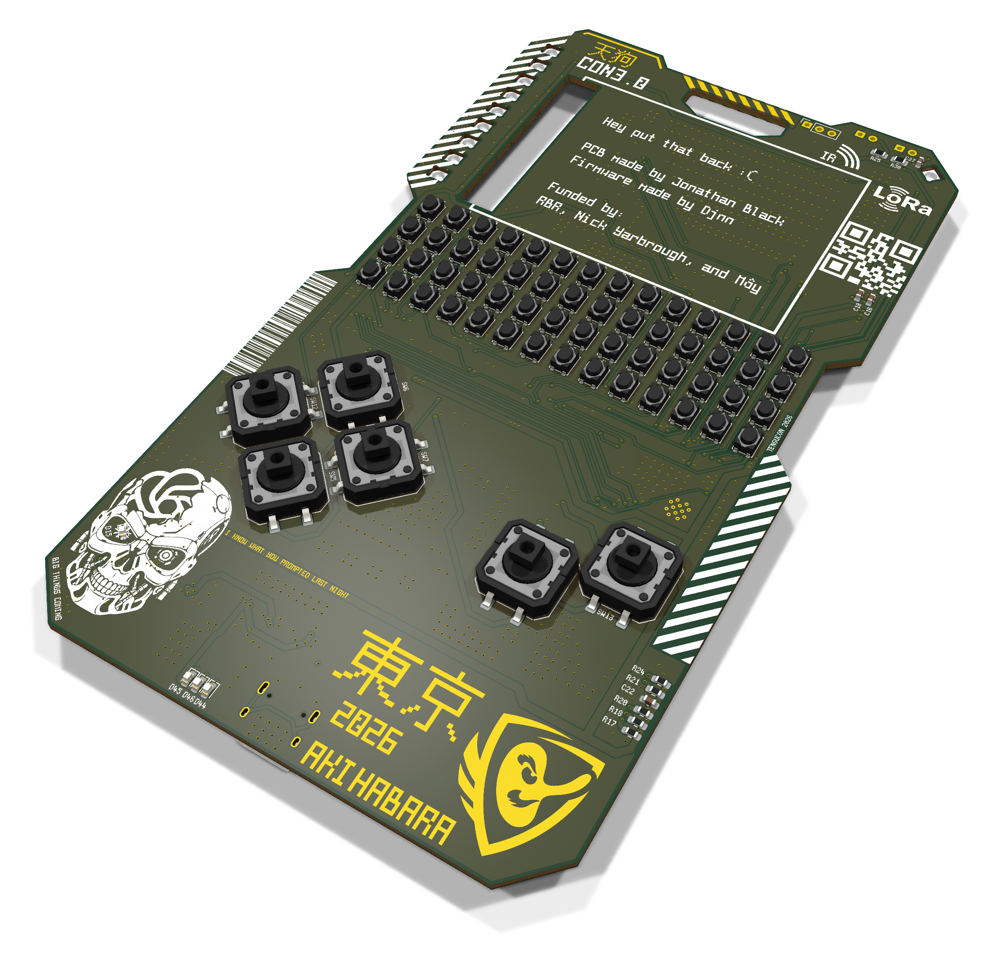
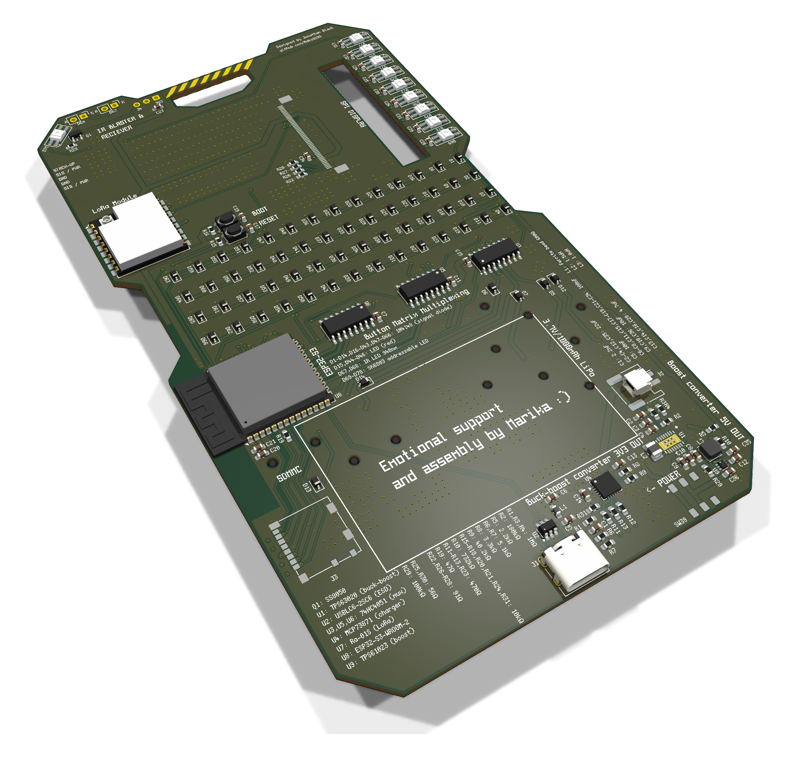
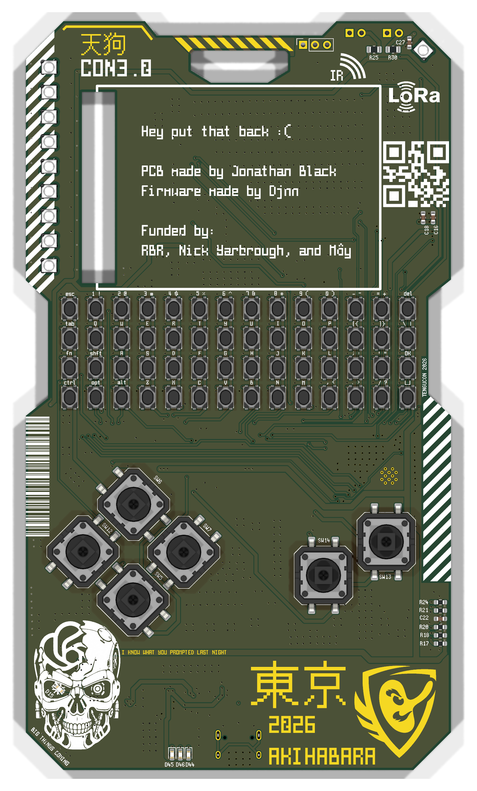
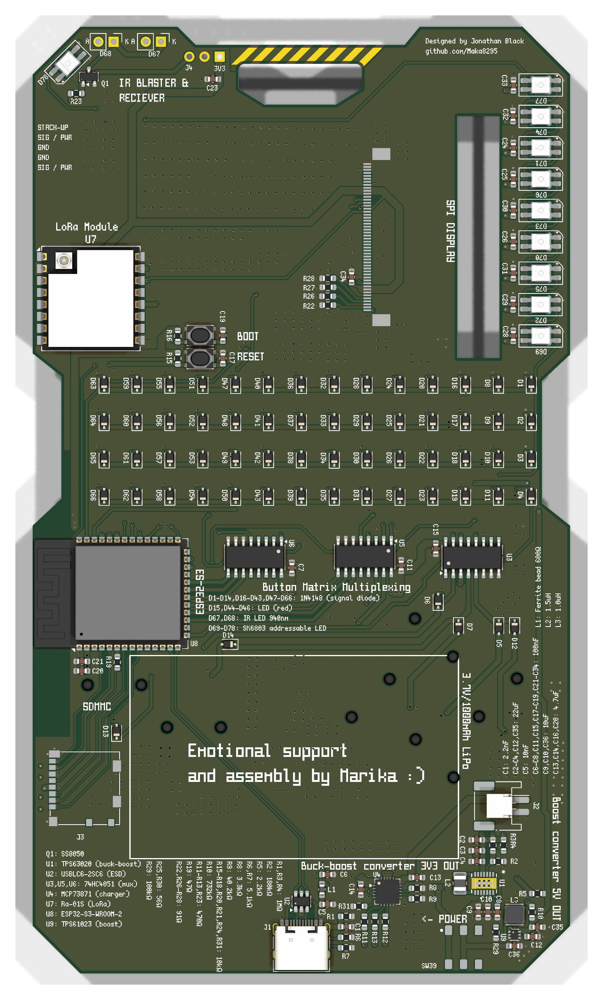
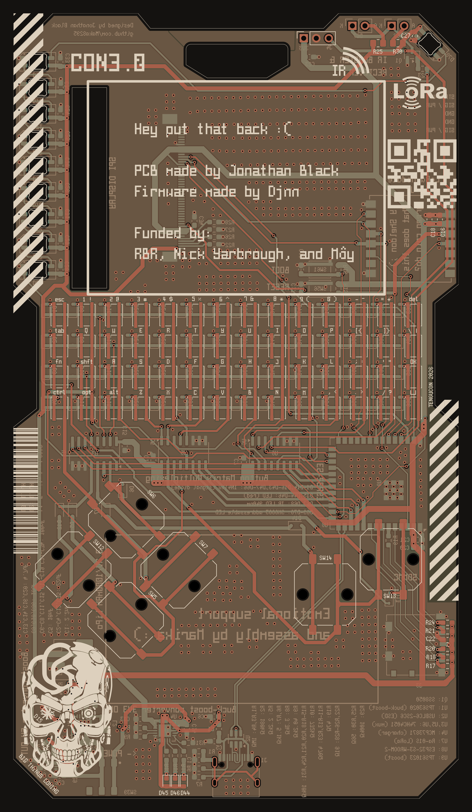
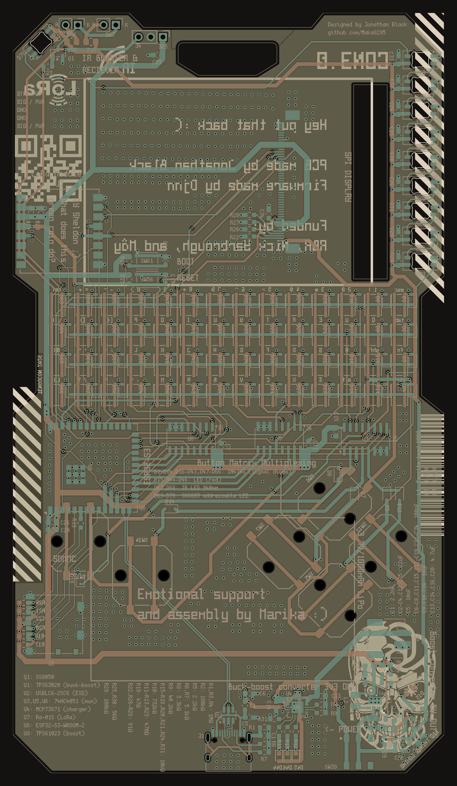
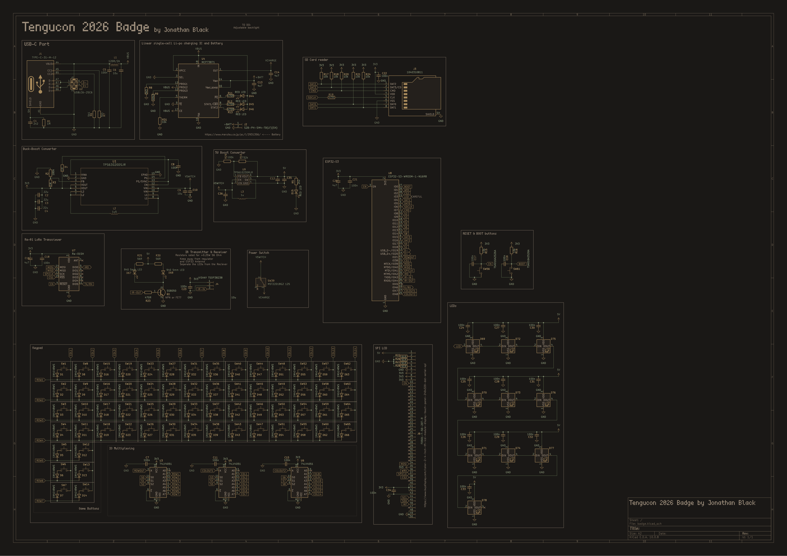

# Tengucon 2026 Badge

The electronic badge for TENGUCON 3.0 (Akihabara, 2026): an ESP32-S3 handheld with a 2.4" SPI display,
a 56-key keyboard, LoRa chat, an IR blaster and receiver, RGB LEDs and a microSD slot, running on a
single-cell LiPo that charges over USB-C.

Hardware by Jonathan Black. Firmware by Djnn, Claude and Jonathan Black.

  
  

## Hardware

| | |
|-|-|
| MCU | ESP32-S3-WROOM-1-N16R8 (16 MB flash, 8 MB PSRAM) |
| Radio | Ai-Thinker Ra-01SH LoRa module (SX1262, 803-930 MHz) |
| Display | 2.4" SPI TFT on a 50-pin 0.5 mm FPC connector |
| Input | 56-key keyboard matrix on 3× 74LV4051 muxes, 6 game buttons, BOOT and RESET |
| LEDs | 10× SK6803MINI-E addressable RGB, red status LEDs |
| IR | 2× 940 nm LEDs driven by an SS8050, TSOP38238 receiver |
| Storage | microSD (Molex 104031-0811) |
| Power | USB-C, MCP73871 load-sharing Li-Po charger, TPS63020 3.3 V buck-boost, TPS61023 5 V boost |
| PCB | 4 layers, designed in KiCad 10 |

Every BOM part in the schematic has `LCSC`, `Manufacturer` and `Manufacturer Part` fields, and
`production/` holds the JLCPCB fabrication and assembly files.

## Images

### 3D renders

SMD assembly only: the hand-soldered through-hole parts (IR LEDs and the IR receiver socket) are left out.

  
  

### PCB editor

  
  

### Schematic

## Repository layout

| Path | Contents |
|-|-|
| `badge.kicad_sch`, `badge.kicad_pcb`, `badge.kicad_pro` | KiCad 10 project |
| `3dmodels/` | Project-local 3D models (Ra-01SH, SWPA3015S inductor) |
| `badge.step` | STEP export of the assembled board |
| `production/` | JLCPCB fabrication outputs (Gerbers, BOM, placement) |
| `firmware/` | Rust firmware, app SDK and tools; see [firmware/README.md](firmware/README.md) |

**Spoiler warning:** `firmware/hunt/` contains the TENGUCON 3.0 scavenger hunt, including all the answers.

## Licence

Copyright © 2026 Jonathan Black.

This project is licensed under [Creative Commons Attribution 4.0 International (CC BY 4.0)](LICENSE).
You may use, modify and redistribute it, including commercially, as long as you give credit, link to
the licence and say what you changed. Please credit it as:

> Tengucon 2026 Badge by Jonathan Black, https://github.com/Maka8295/Badge2026

Third-party material keeps its own licence and is not covered by CC BY 4.0. This includes the
JetBrains Mono font (SIL OFL, `firmware/tools/fonts/OFL.txt`), the Flipper Zero IR files
(GPL-3.0, `firmware/tools/flipper/SOURCE.txt`), the Phrack issue archive, and sponsor logos and
trademarks.
