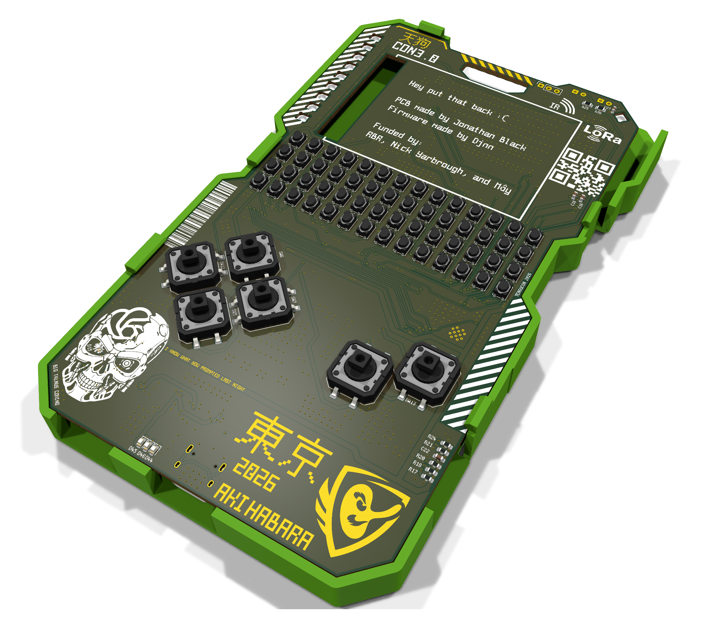
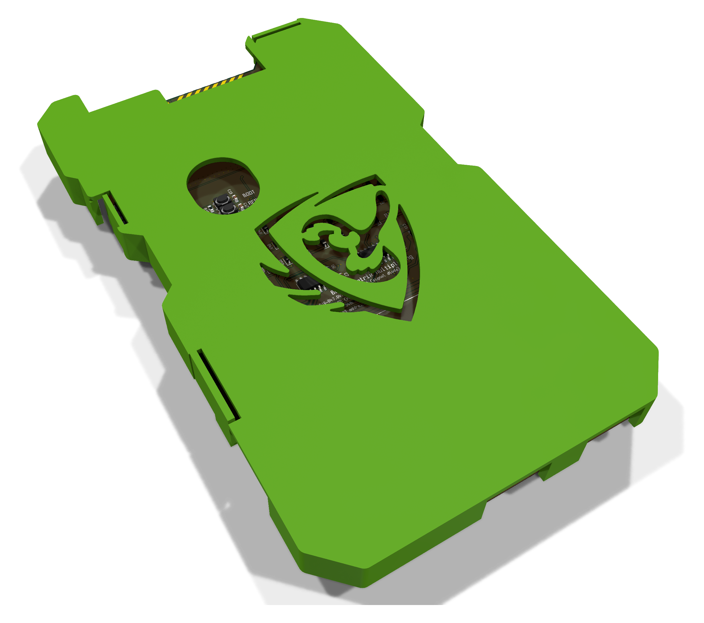
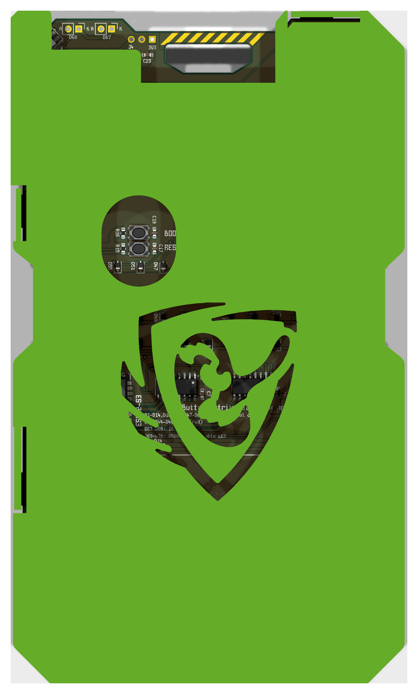
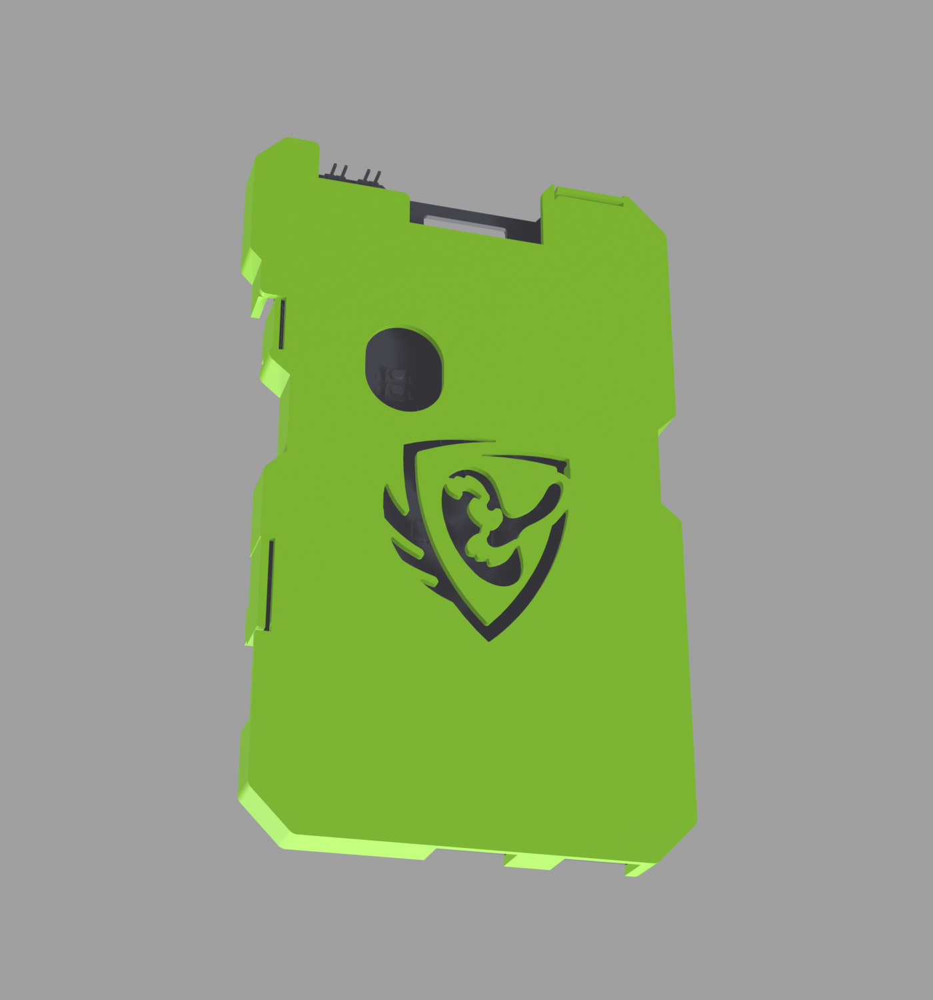
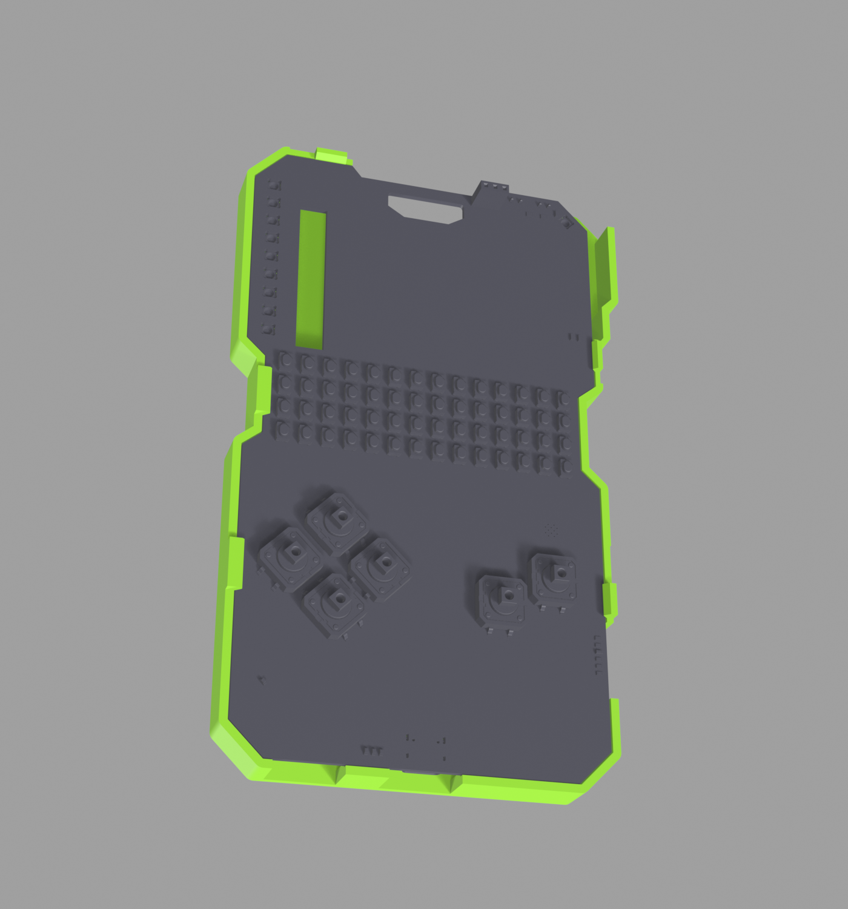

# Tengucon 3.0 Badge Backing

A 3D-printable clip-on back for the badge, designed by community member **Greg**
([Eths33](https://github.com/Eths33)). It comes from his
[tengucon_2.0_badge](https://github.com/Eths33/tengucon_2.0_badge/tree/main/2026) repository
(commit `aba0ecb`) and is licensed under the MIT licence; see [LICENSE](LICENSE) in this folder.
Thank you, Greg!

It snaps over the board edge, so no screws or holes are needed, and it leaves the USB-C port, power switch, SD card, lanyard slot, IR parts and BOOT/RESET buttons open. The front of the badge stays uncovered.

## Renders

The badge in the backing, rendered in KiCad from this repository's board:

  
  
  

Greg's original renders:

 

## Files

- tengucon_3.0_backing.stl: the backing, designed for PETG.
- tengucon_3.0_backing_glow.stl: thinner back (0.75 mm) for semi transparent glow-in-the-dark PLA, with a thicker area round the logo so it glows brighter.
- tengucon_3.0_backing.step: for editing.

## Printing

- Print flat, back on the bed. No supports.
- Designed on a 0.6 mm nozzle at 0.25 mm layers; heights are whole 0.25 mm layers.
- Glow filament is abrasive: use a hardened nozzle.

## Fitting

Hook the left edge (seen from the front) under the two fixed hooks, then press the right side and the top down until the latches click. To remove, pull the latches outward.
